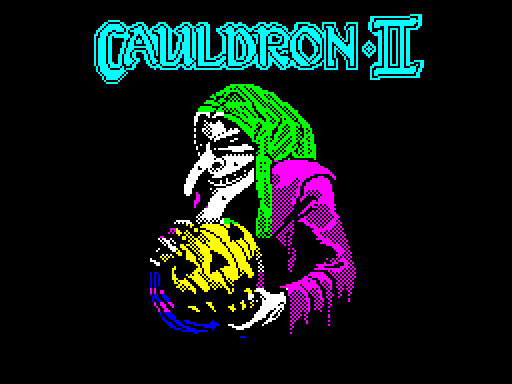
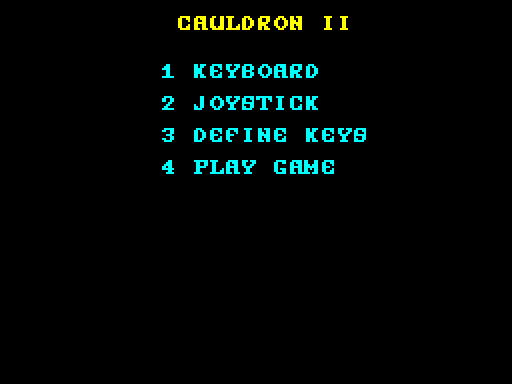
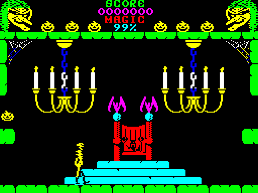
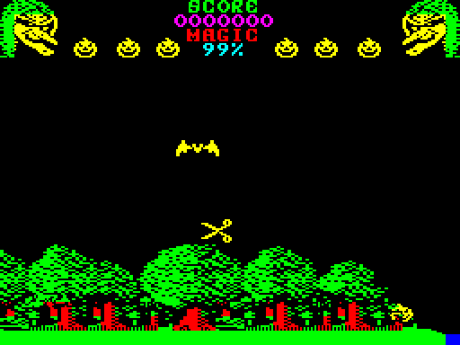
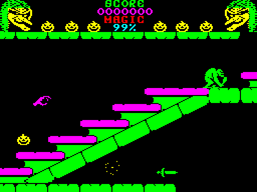
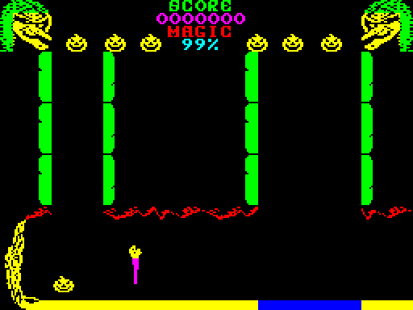
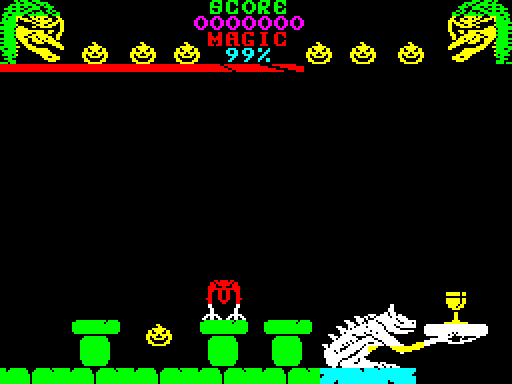
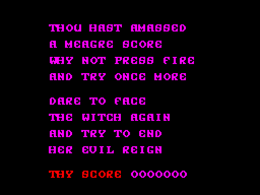

# Cauldron II for the BBC Micro

A port of Palace Software's *Cauldron II: The Pumpkin Strikes Back*
(1986), from the 48K ZX Spectrum to the BBC Micro: a Model B with 32K of
sideways RAM, and the Master 128, from one disc. In 6502 assembly built
with [baron](https://github.com/waitingforvsync/baron).

**[Play it in jsbeeb (Master 128)](https://bbc.xania.org/?autoboot&model=Master&disc1=github:mattgodbolt/cauldron-2-beeb/cauldron2.ssd)**

 
 
 
 

This time you are the pumpkin, bouncing through the witch's castle and
the woods around it, firing magic at whatever comes for you, to put an
end to her evil reign. The whole game is here, transcribed from the
Spectrum's Z80: the title, the menu and credits, every one of the 128
rooms, the pumpkin, the monsters and objects, the magic, game over and
the win, and the music and effects on the BBC's SN76489.

The keys are **Z** and **X** for left and right, **:** and **/** for up
and down, **RETURN** to fire and bounce, and **ESCAPE** to abort the
game. (In jsbeeb on a PC keyboard, **:** is the **'** key.) The menu: **1**
these keys, **2** an analogue joystick, **3** define your own keys,
**4** play.

It needs 32K of sideways RAM: a Model B with two banks, or a Master.
Boot the disc, `cauldron2.ssd`, with SHIFT-BREAK. Getting it into one
16K bank is still to do (`docs/decisions.md`, decision 9).

## No colour clash

The Spectrum's sprites take the colour of whatever character cell they
cross. The port has none of that (decision 10): the screen is MODE 1
laid out in the Spectrum's geometry (decision 2), its lit pixels exactly
the original's at all times, and a sprite keeps its own colour, the one
the original shows it in over an empty room, while what it passes over
comes back in its own colour as it moves on.

MODE 1 shows black and three colours a line; the original's rooms use
up to seven. So each character row gets a palette of its own, changed
in the horizontal blank between rows (decision 11). Yellow stays on
every play row, for the pumpkin; the other two colours are planned per
room from the original's own drawing of it, by a dynamic programme over
the rows (`tools/colours.py`). Where a row hasn't the colour a pixel
needs, an ordered dither of two it has stands in for it: magenta from
red and blue. Over all 128 rooms, all but a fraction of a percent of
the lit pixels show in their own colour (measured 2026-10-31). The
title, the tape's loading screen, has a palette program of its own
(decision 3), and the front end's screens theirs (decision 15).

## Transcribed, routine by routine

*Cauldron II* shares no code with the first game's Spectrum version: it
is hand-written Z80. So the port transcribes it by hand, a routine at a
time, each 6502 routine named for the original's address (`z52372`) and
reading beside it, the original's variables and tables at the same
offsets (`docs/how-it-works.md`). The original's data, its sprites,
tiles, rooms and tunes, comes from the original itself at build time,
every pointer in it relocated (`tools/mkdata.py`); none of it is in this
repository.

Then it is checked against the original running headless, the
Spectrum's on SkoolKit's Z80 simulator and the BBC's in jsbeeb:

- `make passes` plays the original and the port side by side from the
  same start, the same keys held, and compares every byte of the game's
  variables (24000-25099) at every pass of the main loop, on the B and
  the Master. `tools/fuzz.py` does the same with random keys, for
  long runs across several rooms; a failure becomes a scenario
  in `tests/scenarios.txt`.
- `make rooms` draws every room and compares its lit pixels,
  attributes and colours with the original's drawing.
- `make sprites` makes random sprite calls on both and compares the
  results; `make music` every note of the three tunes; `make front` the
  menu, the keys, game over and the win.

The pumpkin's code also had its own check: `tools/playertest.py` runs the
original's and the port's player routines from the same state each pass,
perturbing it until every instruction of the original's had run.

## Sound

The original's music is a two-channel beeper player, which has to
strike every note again each tick to share one speaker. On the SN76489
each voice has a channel of its own, so the tunes play as written: a
held note is held, legato, with a short decay from its attack, at the
original's tempo and pitch (decisions 12 and 18). The notes below the
SN's lowest are a software bass, the channel's volume switched each
half-cycle by the System VIA's timers, so the bass lines keep their
pitch. The effects were single speaker pulses, and are
here too: the same pulse train on an SN channel, so they click as the
original's did (decision 13).

## Speed

The original sets its pace with its HALTs, one a moving object a pass,
and slows as more objects come on; the port waits for the BBC's VSync
where the original halted, so it keeps the same pace when it keeps up.
The BBC's 2MHz 6502 has more to do than the 3.5MHz Z80 did, colouring
each sprite's pixels as it draws them. The aim is play as smooth as
it can be, not the original's timing: with the sprite drawing, the
interrupt, the room drawing and the sound's pulses reworked, the test
scenarios take 0.89 of the original's frames all told, and a room draws
in about half the original's time (2026-10-31; `make passes` prints the
frames, `make timeline` says which run over and why).

## How it's made

The port is made the way the
[Cauldron](https://github.com/mattgodbolt/cauldron-beeb),
[Chuckie Egg 2](https://github.com/mattgodbolt/chuckie-egg-2-beeb) and
Ninja Massacre ports were, after Kieran Connell's
[beeb-port-kit](https://github.com/kieranhj/beeb-port-kit): the original
is the specification, every deviation is a numbered decision in
`docs/decisions.md`, and the port is built one layer at a time, each
checked against the original before the next.

This is an unofficial port. *Cauldron II* is by Palace Software: plot and
graphics by Steve Brown, code by Richard Leinfellner, sound by Richard
Joseph. The original's files are not in this repository: `make fetch`
downloads them from
[Spectrum Computing](https://spectrumcomputing.co.uk/entry/851/).

## Building

You need [baron](https://github.com/waitingforvsync/baron) (at
`../baron/build/src/baron` or on the PATH), Node, and
[uv](https://github.com/astral-sh/uv) for the Python tools.

```sh
npm ci          # the jsbeeb harness (jsbeeb-mcp)
make venv       # .venv with SkoolKit, Pillow and py65
make fetch      # the original, from Spectrum Computing
make            # build/cauldron2.ssd
make run        # boot it in jsbeeb, screenshot to shots/run.png
make zx         # the original, loaded, as build/c2.z80
make disasm     # the original's disassembly, build/c2.skool
make check      # every check (MODEL=Master for a Master 128)
make disc       # from a clean tree: the disc to cauldron2.ssd
```

## Layout

| Path | What |
|---|---|
| `src/` | the port, in 6502 assembly for baron |
| `tools/` | the build's converters, the harness for jsbeeb (`beeb.mjs`, `play.mjs`) and for the Spectrum (`zx.py`, on SkoolKit), and the checks |
| `disasm/` | SkoolKit control files: the original's disassembly, labelled |
| `tests/scenarios.txt` | the pass-by-pass scenarios |
| `docs/how-it-works.md` | the transcription's conventions |
| `docs/research/` | how the original works |
| `docs/decisions.md` | every call the port makes that the original didn't |
| `docs/journal.md` | how it got here, in order |
| `original/` | `make fetch` puts the original's files here (never committed) |

## Thanks

Palace Software for the game; Kieran Connell for the port kit; Rich
Talbot-Watkins for baron; Richard Dymond for SkoolKit; dmsc for the
zx02 unpacker; the jsbeeb contributors; and Spectrum Computing (ZXDB)
for the original.
